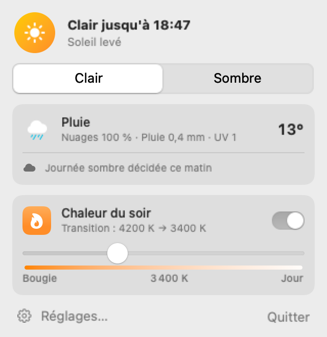
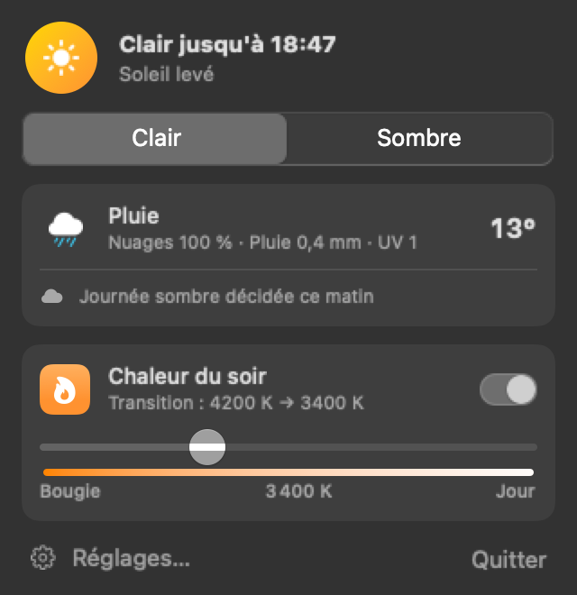
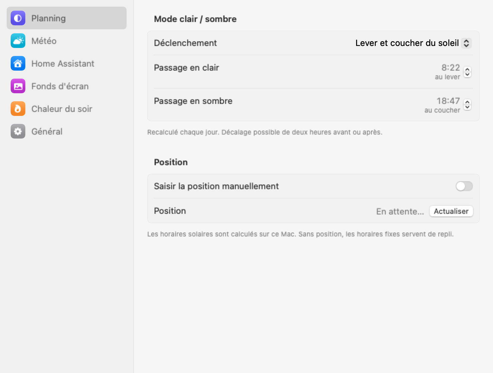
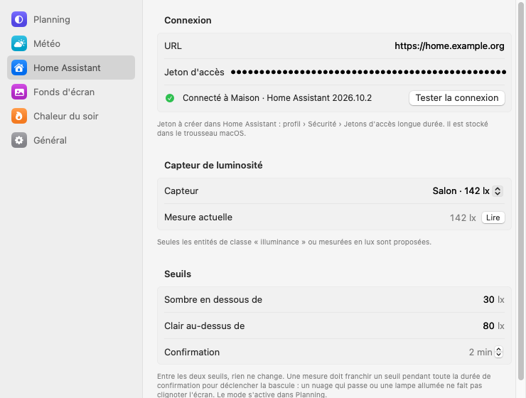
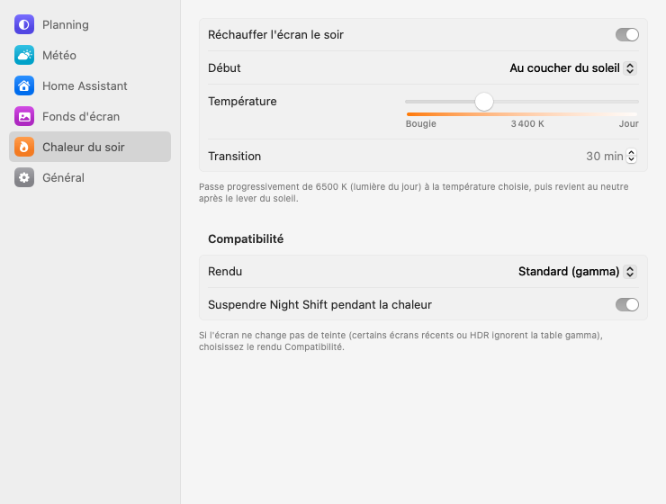
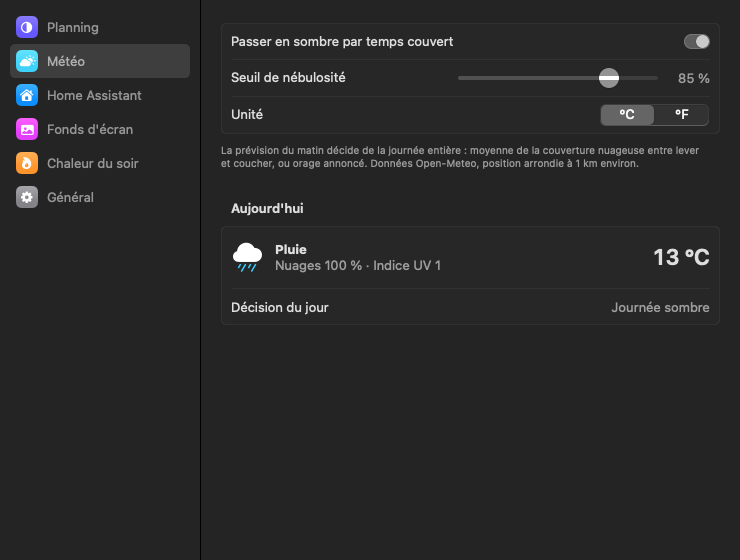
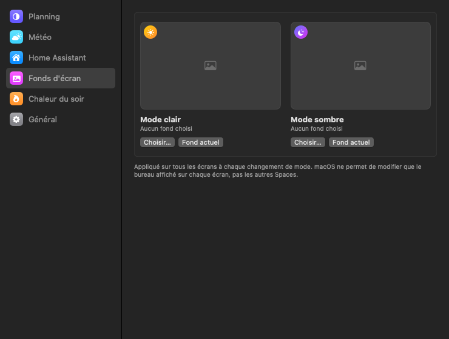
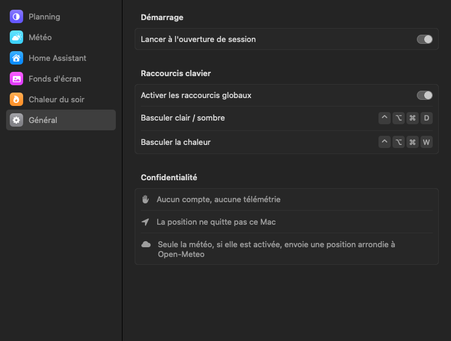

# No Bleeding Eyes

[](https://github.com/alepee/no-bleeding-eyes/actions/workflows/ci.yml)
[](https://github.com/alepee/no-bleeding-eyes/releases/latest)

A macOS menu bar app that tunes your screen to the time of day: light or dark appearance, wallpaper, colour temperature. Inspired by [Solace](https://www.theodorehq.com/solace/).

Website: [no-bleeding-eyes.lepee.dev](https://no-bleeding-eyes.lepee.dev)

<p>
  
  
</p>

## Features

- **Light / dark schedule**: sunrise and sunset computed on your Mac, each with a ±2 h offset; or fixed times; or manual.
- **Weather**: the first forecast of the day decides whether the whole day stays dark (mean cloud cover above a threshold, or a thunderstorm). Shows sky, temperature (°C/°F), clouds, rain and UV. Data from [Open-Meteo](https://open-meteo.com), location rounded to about 1 km.
- **Ambient light (Home Assistant)**: a lux sensor drives the appearance. Two thresholds (hysteresis) and a confirmation delay prevent flicker. Falls back to the sun when the sensor goes silent for 10 minutes. The token is stored in the Keychain.
- **Wallpapers**: one for light mode, one for dark mode, applied to every display.
- **Evening warmth**: a gradual shift from 6500 K to the temperature you pick (down to 1900 K), at sunset, at a fixed time or all the time; back to neutral after sunrise. Rendered through gamma tables, or through an overlay for displays that ignore gamma. Night Shift is paused meanwhile so filters do not stack.
- **Global shortcuts**: `⌃⌥⌘D` toggles light / dark, `⌃⌥⌘W` toggles warmth. A manual toggle (or a change made in System Settings) holds until the next scheduled change.
- Launch at login, multiple displays, no account, no telemetry.

The interface is in French for now.

## Install

Download `NoBleedingEyes.dmg` from the [latest release](https://github.com/alepee/no-bleeding-eyes/releases/latest) and drag the app into `Applications`. Requires macOS 13 or later, Apple Silicon or Intel.

Releases are not notarized yet. On first launch macOS refuses to open the app: go to **System Settings › Privacy & Security** and click **Open Anyway**, or run:

```sh
xattr -dr com.apple.quarantine /Applications/NoBleedingEyes.app
```

## Development

macOS 13 minimum. The Command Line Tools are enough to build; tests need Xcode (XCTest does not ship with the Command Line Tools).

```sh
scripts/build-app.sh            # release build → build/NoBleedingEyes.app (ad-hoc signed)
scripts/build-app.sh debug
open build/NoBleedingEyes.app
swift test                      # with Xcode
```

### Releasing

Push a `vX.Y.Z` tag. The `Release` workflow runs the tests, builds a universal app stamped with the tag version, and publishes `NoBleedingEyes.dmg` and `NoBleedingEyes.zip` to a GitHub release.

Signing and notarization switch on when these repository secrets exist:

| Secret | Content |
| --- | --- |
| `MACOS_CERTIFICATE` | Developer ID Application certificate, `.p12` encoded in base64 |
| `MACOS_CERTIFICATE_PASSWORD` | password of the `.p12` |
| `NOTARY_KEY` | App Store Connect API key, `.p8` encoded in base64 |
| `NOTARY_KEY_ID` | key ID |
| `NOTARY_ISSUER` | issuer ID |

Without them the app is ad-hoc signed.

### Screenshots

Debug builds render every view to PNG, in light and dark, with sample data and without touching the system:

```sh
scripts/build-app.sh debug
build/NoBleedingEyes.app/Contents/MacOS/NoBleedingEyes --snapshot docs/screenshots
```

| Schedule | Home Assistant | Evening warmth |
| --- | --- | --- |
|  |  |  |
| **Weather** | **Wallpapers** | **General** |
|  |  |  |

## Documentation

- [Architecture](docs/architecture.md): decision engine, system integrations, private APIs.

## Support

If the app saves your eyes, you can [sponsor its development](https://github.com/sponsors/alepee).
